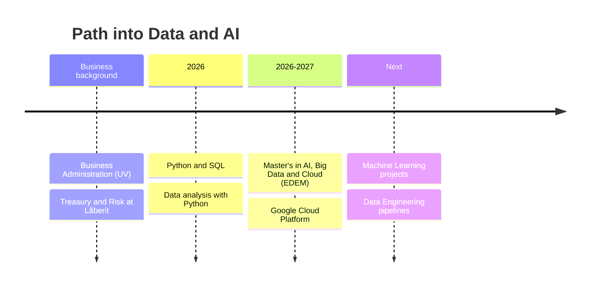

<div align="center">


<a href="https://git.io/typing-svg">
  
</a>

<br/>


</div>

---

## 👋 About

I'm a **Business Administration graduate** from the University of Valencia, currently transitioning into **data analytics and artificial intelligence**.

I'm pursuing a **Master's degree in AI, Big Data and Cloud** at EDEM Escuela de Empresarios (2026–2027).

My background in business and financial operations has given me a solid understanding of how organisations work and how **data can support better decision-making**.

```python
class Carlos:
    location  = "Valencia, Spain"
    background = ["Business Administration", "Treasury & Risk"]
    learning  = ["Python", "SQL", "Machine Learning", "Google Cloud"]
    languages = {"Spanish": "native", "French": "C1", "English": "fluent"}

    def mission(self):
        return "Bridge business knowledge and data to make better decisions"
```

---

## 💼 Experience

<table>
<tr>
<td width="140" align="center"><b>8 months</b><br/><sub>Treasury & Risk</sub></td>
<td>

**Treasury & Risk — Lãberit**

- 🧾 Worked with **Microsoft Dynamics 365 Business Central**.
- 🏦 Managed **bank reconciliations** and financial records.
- 📑 Handled **customer and supplier invoicing**.
- 📊 Monitored **accounts receivable and payable**.
- ⚙️ Gained experience in financial operations and business processes.

</td>
</tr>
</table>

---

## 🎓 Education

| Period | Programme | Institution |
|:---:|---|---|
| **2026 – 2027** | 🚀 Master's Degree in **AI, Big Data & Cloud** | EDEM Escuela de Empresarios |
| **Graduated** | 📘 Bachelor's Degree in **Business Administration** | Universitat de València |

---

## 🛠️ Technical Skills

<div align="center">


<br/><br/>


</div>

### 🎯 Currently focusing on

| Area | Focus |
|---|---|
| 🐍 **Python** | Data analysis and machine learning |
| 🗄️ **SQL** | Databases and data management |
| ☁️ **Google Cloud Platform** | Cloud services for data workloads |
| 🔧 **Data Engineering** | Pipelines and fundamentals |
| 🤖 **Machine Learning** | Real-world applications |

---

## 🗺️ Roadmap



---

<div align="center">

<sub>📍 Valencia, Spain &nbsp;·&nbsp; 🗣️ Spanish · French (C1) · English</sub>


</div>
